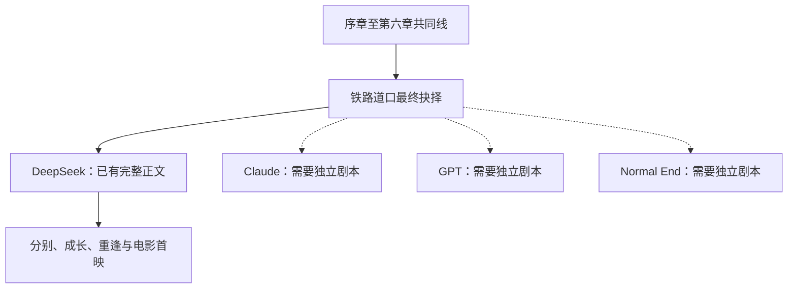

# 《未抵达的心意》剧本分析与开发方案

整理日期：2026-10-18。本文区分原稿事实、工程现状和开发建议；建议尚未修改原稿或游戏代码。

## 1. 分析依据

- 原稿：`D:/ds-gal/未抵达的心意.md`，204,120 字节，9,132 行。
- 原稿 SHA-256：`94ef1c94d6157e6fda6f8ad1b2b5456fcd9977cdb8b98a7d17f22501775643d3`。
- 原稿含约 42,431 个汉字；这个统计包括重复内容、企划说明和标题，不等于清稿后的游戏字数。
- 仓库基线：`master`，`d367247a36488be63adcbb9065bb62ea9c735906`。
- 已阅读游戏的全部四份 `.rpy` 源文件、构建/部署脚本和本地服务器；当前没有 SDK、正式素材或 Web 构建产物，不能据此宣称运行验收通过。
- 原稿暂在仓库外。执行清稿任务时，将其原样归档到 `story/source/未抵达的心意-v1.md`，以便协作和追溯。

## 2. 剧情理解

故事的核心是：主角逐渐学会诚实表达感情、承担选择的后果，并在爱情中尊重双方的创作与人生。天台、笔记本、电影《候鸟》、钢琴与旧录像是反复出现的叙事线索。

| 角色 | 剧情功能与成长 | 游戏呈现要点 |
| --- | --- | --- |
| User | 从学业失序、依赖他人帮助和回避感情，走向主动选择及独立创作 | 第一人称旁白；首版保留原稿称呼 User；旁白与主角对白分开 |
| DeepSeek | 最初相遇的创作搭档；从期待四人永远在一起，成长为独立作家 | 天然、冒失只是外在表现；告白、失落和独立决定需要独立表情与停顿 |
| Claude | 从误会开始的现任恋人，后来成为未正式结束关系的旧爱；追求钢琴事业 | 保留骄傲与脆弱并存，音乐演出和机场分别承担情绪转折 |
| GPT | 学习上的陪伴者与文学编辑；从隐藏感情走向主动表达 | 不能仅作为提示答案的工具角色；保留独处与失落的镜头 |

| 章节 | 剧情推进 | 建议制作单元 |
| --- | --- | --- |
| 序章《天台上的少女》 | 天台偶遇、笔记本遗失 | 1 场 |
| 第一章《认错的人》及续篇 | 误向 Claude 告白、归还笔记本、约定拍电影 | 3 场 |
| 第二章《重新开始》 | 社团停滞、母亲的眼泪、补基础、GPT 辅导、疏忽 Claude | 9 场 |
| 第三章《三个人的夏天》 | 社团重建、《候鸟》、四人演出、Claude 告白、关系裂痕 | 8 幕＋1 个合并尾声 |
| 第四章《无法传达的爱恋》及后篇 | Claude 出国、异地疏远、三年跳时、DeepSeek 告白 | 14 场 |
| 第五章《再一次，站在选择面前》及终篇 | Claude 回国、母亲检查、GPT 告白、校友重聚 | 12 场，长场内再分镜 |
| 第六章《选择的代价》 | 三位女主给出期限、铁路道口最终选择 | 5 场 |
| DeepSeek《最初的约定》 | 表明心意、结束旧关系、正式交往、法国进修、分别、四年后重逢、改编电影、天台尾声 | 14 场，续篇并回原场 |

清稿后按上述粒度可规划约 67 个顶层制作单元，其中共同线 53 个、DeepSeek 线 14 个。这是建议的工程拆分数，不是原稿中独立场景的机械计数。

DeepSeek 结局的关键链条必须保留：先表明心意 → 与 Claude 正式结束关系 → 向 GPT 明确答复 → 正式交往 → 尊重她的写作梦想 → 双方谈清暂时分别 → 各自成长 → 重逢后重新选择 → 完成共同电影。不能缩成“选择女主后直接幸福结局”。

## 3. 路线范围与发布边界

原稿第 7263–7269 行给出四个互斥选项，但只有 DeepSeek 的结局正文（第 7290–9132 行）。Claude、GPT、Normal End 都没有独立结局正文。共同线里对他们的描写不等于已完成个人线。



建议的三个发布范围：

1. **体验版**：序章＋第一章，展示初遇、认错人和共同创作的起点，不提前暴露后续结局。
2. **DeepSeek 路线版**：全部共同线＋DeepSeek 完整结局。最终选择页可展示四条方向，但其余三项禁用并标明“未开放”；所有分发说明明确只有一条可玩个人线。
3. **完整多路线版**：补齐另外三份路线剧本、独立告别与成长逻辑、素材和回归验收后，再开放对应入口。

首版不加好感度、日历养成或数值门槛。原稿中的关键关系已经写死，当前明确分歧只在最终选择；中途增加改变关系的选项会要求重写共同线。若后续需要前置分支，应先修改剧本和路线图，再增加状态。

## 4. 清稿时必须处理的具体问题

| 问题 | 原稿定位 | 建议处理 |
| --- | --- | --- |
| 第三章尾声重复 | 2108–2258 与 2260–2650 | 建议保留后一个更详细版本；前版独有信息逐项核对后记录去留，不能两版连续播放 |
| 重复对白 | 1785，同一句在一行出现两次 | 保留一次 |
| 续篇开头重述上一段 | DS-06：7978–7986 与 7996–8002；DS-12：8692、8696 | 续篇并回同一场，只去掉重叠部分，不删掉独有发展 |
| 多个版本与章节标题混在一起 | V1.0、V1.2–V1.6；第五章终篇有另一个标题 | 为游戏固定统一章节名；原版本标签与“下一章”作者说明进入编辑记录 |
| 时间线矛盾 | 第三章从寒假后推进到“夏天”；第四章称毕业后出国，但出国当天 User 仍坐在教室，之后还在备考 | 先制作学年/月度时间表。建议将 Claude 离境设为毕业前的提前赴欧学习，具体时间及第三章文化祭月份需编辑确认 |
| 升学年制与地点混用 | 高考、一本、QQ、4500 人年级，与文化祭、东京、日式学姐设定并存 | 制定一份架空校园设定；首版保留中文成长语境，不擅自改成日本升学制度。四年后东京地点的过渡需补明 |
| 回忆归属不一致 | 7149–7157 称向 GPT 问过“还来得及吗”，前文明示问的是班主任（726–730） | 改为“我记得你曾经担心过……”等不改变事件归属的表述，或补足曾向 GPT 问过的场景 |
| 笔记本道具流转不连续 | 6626 交给 User，DS-02 仍留在 User 手中，8134 又从 DeepSeek 包中拿出 | 选择一条连续保管关系，补一个取回翻阅再托付的动作；到首映礼归还时必须能追溯 |
| Claude 的留学国家未明 | 前文写欧洲，8028 回忆又将 Claude 与法国绑定 | 明确 Claude 的目的地或把这句改为欧洲范围的回忆，不假定两人去了同一国家 |
| 首映礼临时取回与最终归还 | DS-13 的化妆台、背包、归还动作 | 用动作说明区分临时翻阅和正式归还，避免观众以为已经归还过 |
| CG 与 BG 编号不连续且含义混杂 | BG 缺 001、012–017；CG-001–005 与尾声六张回忆列表未建立映射 | 新增语义资产 ID，并保留旧编号到新 ID 的对照；不按旧编号猜测缺失资产 |
| 引用图与素材状态混淆 | 原稿有 31 个外链图片引用 | 归类为风格参考，制作清单单独记录实际文件、作者和使用许可；发布包使用已落实的原创或获授权资产 |
| 长消息、邮件和视角切换 | 5-07 长邮件；Claude 独处场景；多处长旁白 | 首版仍用标准对话框分段和场景字幕表达，保留信息及说话人；晚些再评估手机专用界面 |

这些是清稿建议，不是已获授权的剧情重写结果。体验版可先推进不依赖后期时间线的序章及第一章；共同线批量移植和大规模配音需等清稿版本固定。

## 5. 与现有工程衔接

| 现有内容 | 处理方式 |
| --- | --- |
| `game/script/00_definitions.rpy` 的白鲸、小鲸 | 替换成 User、DeepSeek、Claude、GPT、未知少女和必要配角；每个女主固定 `voice_tag` |
| `game/script/chapter01.rpy` 的测试 `start` | 正式体验版可运行后移除旧测试入口；由独立 `02_flow.rpy` 持有唯一 `start` |
| `game/script/01_fonts.rpy` | 保留全局字体替换；标准 GUI 中再明确设置文本、姓名和界面字体 |
| `game/options.rpy` | 展示名改为《未抵达的心意》，构建标识保留 `whalegal`；固定存档目录，后续不随展示名变更 |
| 缺 `gui.rpy`、`screens.rpy` | 使用同一 SDK 的官方 GUI 模板，定点合入配色和字体；在临时项目生成后复制所需文件，避免覆盖现有工程 |
| Bash 构建和 nginx | 保留现有 Linux 发布链路；补 Windows PowerShell 构建入口适配当前开发电脑 |
| 渐进下载规则 | 保留图/背景音乐/语音按需加载；用真实语音验证首播是否漏播，不只检查文件 URL |
| `story/` 与 `tts/` 空目录 | 依次增加原稿归档、清稿/映射记录、配音台账和离线生成工具 |

运行时采用 Ren'Py 原生 `.rpy`：一章一文件、一场一稳定 `label`，每个场景自行设置背景、角色、音乐状态。使用原生 `call`/`return` 串联共同线，`jump` 进入互斥个人线。按照官方示例 The Question 的做法组织角色、可变状态与分支，不增加外部剧情解释器。

文案流为：**原稿归档 → 清稿 Markdown 基线 → 人工移植 `.rpy` → Ren'Py 官方对白导出 → 配音台账与音频**。归档与清稿是审稿依据，进入开发后 `.rpy` 是运行对白的权威版本；改词先改 `.rpy`，导出文件禁止手工修改中文，台账只维护日语演绎和合成状态，避免双向同步。

### 目录职责

```text
story/source/未抵达的心意-v1.md     原样归档
story/chapters/00_prologue.md        序章清稿，后续章节同目录
story/editorial-log.md              去重、段落和时间线决策
story/scene-map.csv                 场景 ID、原稿行号、label、清稿文件
story/asset-manifest.csv            语义 ID、类型、实际文件、来源、许可、状态
story/voice_map.json                稳定对白 ID、角色、中文导出值、日语、音线与状态
game/script/00_definitions.rpy       角色、常量、原生配音配置
game/script/01_fonts.rpy             中文字体替换
game/script/02_flow.rpy              唯一开始入口和共同线顺序
game/script/03_assets.rpy            背景、立绘、位置变换、音频名称
game/script/prologue.rpy             序章
game/script/chapter01.rpy            正式第一章，后续至 chapter06.rpy
game/script/routes/deepseek.rpy      DS-01 至 DS-14
game/script/routes/selection.rpy     已开放路线选择与存档状态
game/gui.rpy + game/screens.rpy      SDK 标准 GUI 及本项目样式调整
game/screens/gallery.rpy            后期 CG 回想页
tools/build_web.ps1                 Windows 构建、同步和本地预览
tts/synthesize.py                   后期离线合成与增量生成
docs/qa/                           桌面与浏览器验收记录
```

这是分阶段目标结构，体验版只创建当前使用的文件，不提前创建空实现。

### 状态与存档约定

- 角色、不可变配置用 `define`；当前路线等可变游戏状态用 `default`。
- CG 解锁、已通关结局使用 `persistent`，只在真正看见对应画面或到达结局时写入。
- 不把当前路线放在 `persistent`，以免一个存档的选择污染另一个存档。
- 稳定 label 和对白 ID 在首次提供存档/配音后保留；改词不重编号，新增句子使用新 ID。
- 不写自定义存档、历史、回滚或音频混音器；这些交给 Ren'Py。

## 6. 素材与配音方案

工作区另有 `assets_src/characters/heroine/references/`，包含四张角色参考原图及说明，尚未纳入当前 Git 提交。其 README 区分日常装、长发礼服款、编发文具款与 Q 版表情，并说明角色姓名尚未指定。本方案只记录这组现有参考，不自动把它绑定到 DeepSeek，也不将参考原图视为可直接上屏的校服立绘；角色对应关系确定后再制作 `game/images/` 中的游戏资产。

### 体验版最小素材包

- 背景三处：春日天台、放学后操场、图书馆。图书馆两场复用一张背景。
- DeepSeek 校服立绘一套，含普通、笑、慌张、失落四种表情；Claude 校服立绘一套，含普通、恼怒、脸红三种表情。GPT 在第二章登场，再追加她的资产。
- 角色表先统一发色、制服、比例、画风和表情命名。未知少女与 DeepSeek 使用同一外观，但前者名字显示“？？？”。
- 一套简洁标题与对话 UI；日常、轻喜剧、温柔创作三类原创/已落实使用许可的 BGM，以及碰撞、预备铃两类音效。
- 可先用 Ren'Py 原生纯色背景、文字场景标识与角色名完成流程验收，再替换正式素材。天台 CG 可放在演出打磨阶段，不阻塞文字流程。

### 全线素材优先级

先覆盖可复用地点：教室/图书馆/走廊/社团/音乐教室/天台/住处/机场/公园；随后补大学、出版社、咖啡馆、医院、音乐厅、铁路道口、交流会、首映后台。早晚、季节、校内新旧场景优先做同一地点变体，不按每个场景重复制作一张背景。

关键 CG 首批按结局回忆列表安排六张：天台初遇、水族馆后的首次告白、DeepSeek 机场告别、四年后重逢、电影首映、春日天台尾声。母亲流泪、GPT 辅导、四人文化祭、Claude 机场分别、铁路抉择和正式拥抱另列优先级，不与这六张混用编号。每张 CG 明确实际出现的 label 和解锁点。

文化祭所列《WHITE ALBUM》《SOUND OF DESTINY》《届かない恋》先保留为文案中的歌曲指代。实际发布音频按项目可取得的原创/授权方案制作，不能把引用歌名当成已有音频资产。完整声乐演唱需要独立制作，普通 TTS 不承担演唱。

### 日语 TTS

推荐流程为：**稳定中文对白 ID → 人工审校日语口语文本 → 固定角色音线 → 离线合成 → 文件校验 → Ren'Py 按 ID 播放**。不把中文原句直接交给日语音线，也不在玩家浏览器内运行模型。

先以 VOICEVOX HTTP 引擎做三位女主各一组短样音，覆盖日常、惊讶、低落和告白；对 Claude 的语气和 GPT 的成熟度不满意时，再评估 Style-Bert-VITS2。音线确认后才批量生成。浏览器/SDK 的格式验证决定 OGG 或 MP3 最终方案；格式一旦选定，配置、文件名和缓存键统一。

利用官方 `config.auto_voice = "audio/voice/{id}.ogg"` 和 `voice_tag`。中文移植时显式固定 `id`，例如 `prologue_s01_0001`；缺配音文件时允许继续文字阅读，并在发布校验中列出缺失清单。若渐进语音首播因网络加载而漏播，应调整首章预载或取消对应语音渐进下载规则后再发布。

`voice_map.json` 保留 `id`、`speaker`、`source_zh`、`spoken_ja`、`voice_profile`、`status`。音频增量缓存还需包含日语文本、引擎版本、音线和语速/情感参数；中断后可续跑，失败项报告到具体对白 ID。首版只配女主对白，User、旁白和配角保持文字，后续按试听效果扩大。

## 7. 分阶段开发与验收

| 阶段 | 可交付成果 | 验收条件与依赖 |
| --- | --- | --- |
| M0 清稿与范围固定 | 归档、场景映射、体验版清稿、编辑问题清单 | 序章/第一章逐段可追溯；确定其为体验版。后期矛盾记录为共同线制作的前置条件 |
| M1 体验版 | 序章＋第一章三场；标题、对话、历史、设置、存读档；桌面及 Web 包 | 无重复 start、无缺 label；可通读并回标题；中文正常；桌面和浏览器存读档可恢复；见单独实施计划 |
| M2 DeepSeek 全线文字版 | 共同线及 DS-01–14；路线状态、章节转场、正式结局标记 | 第四章三年跳时、DS 四年跳时、告别关系及笔记本交接连贯；未写路线不开放；全程可完成 |
| M3 演出与回想 | 正式背景/立绘/CG/BGM/音效；回想画廊 | CG 仅在对应画面解锁；多角色不遮挡姓名/对白；手机横屏可操作；各场清理前场残留音乐与立绘 |
| M4 日语配音 | 审校台账、三角色固定音线、离线合成与语音设置 | 中文/日语逐句对应；ID 无重复；失败可续跑；重播、音量、静音、跳过和慢网首播实测 |
| M5 Web 发布 | 构建说明、版本说明、nginx 部署与浏览器验收记录 | MIME、Range、缓存更新、持久化存档、音频启动、冷启动传输量实测；没有占位素材或失效音频 |
| M6 其余三线 | 独立剧本和各路线小计划，然后代码与素材 | 正文先完成；路线互斥；其余女主的答复与各自主线有交代；Normal End 不能只是突然退出 |

M3 的角色样式和体验版素材可在 M1 期间提前确定；全量素材与配音应建立在已通过文字通读的版本上。每阶段保留上一阶段的可玩版本，逐章加内容，不做一次性重构。

### 共同线导入批次

1. 第二章 9 场：先让三女主全部登场，并通读学习成长线。
2. 第三章 8 幕＋合并尾声：检验四人场景、演出、内心独白与视角切换。
3. 第四章 01–08：修正离境时间后实现分别与异地疏远；09–14：用清晰字幕完成三年跳时和水族馆告白。
4. 第五章 01–07：回国、作品集与三封消息；08–12：医院、演出压力、两位告白、校友重聚和笔记本托付。
5. 第六章 01–05：三场带日期的约定和最终抉择；完整内容审核后只开放有正文的分支。
6. DS-01–05：主动表明心意、正式结束旧关系、明确答复、正式交往。
7. DS-06–09：法国创作计划、天台、双方谈清暂时分开、机场告别。
8. DS-10–14：四年跳时、作品改编交流会、重新告白、电影首映、天台尾声与六张回忆的解锁核验。

每批检查原稿映射、缺失对白、场景资源、label 连通性和上批末尾的转场，再继续下一批。中途存档读回与回滚尤其要覆盖路线选择、时间跳转和章节边界。

## 8. 开始制作前的三项编辑决定

建议基线是“青春成长与恋爱”为主、喜剧为调节；首个版本是序章＋第一章体验版；后续完整现有文本先作为 DeepSeek 路线版。以下决定会影响后续清稿和资产投入，执行对应部分前再确认：

1. 保留架空校园与中文升学语境，还是统一到具体国家/制度？
2. Claude、GPT、Normal 三份独立结局由谁补写，何时进入范围？
3. 女主统一画风及日语样音采用哪组角色方案？先用小样选择，不直接批量生产。

现在可以直接开始不依赖这些决定的体验版清稿、SDK 运行验证和文字切片。

## 9. 成熟实现参考

官方在线文档目前显示 8.5.4；项目目标仍是 README 指定的 8.5.3。实现时以本机同版本 SDK 模板和 lint/运行结果为准，不因为参考文档版本变化自动升级工程。

- [Ren'Py 官方 The Question 示例源码](https://github.com/renpy/renpy/blob/master/the_question/game/script.rpy)：Character、default、menu、jump 与原生演出。
- [官方 GUI 定制](https://www.renpy.org/doc/html/gui.html)：复用标准 GUI、字体和分辨率调整。
- [保存、读取与回滚](https://www.renpy.org/doc/html/save_load_rollback.html)：剧情流程和状态交给引擎。
- [持久数据](https://www.renpy.org/doc/html/persistent.html)：结局、CG 解锁。
- [自动配音](https://www.renpy.org/doc/html/voice.html#automatic-voice)：对白 ID 与文件映射。
- [翻译 ID](https://www.renpy.org/doc/html/translation.html#tips)：显式固定 say 语句的 ID。
- [Web 支持](https://www.renpy.org/doc/html/web.html)：WASM、渐进下载、音频及浏览器限制。

后续每个通过验收的阶段分别提交，并推送 GitHub；SDK、模型权重、缓存和 Web 构建产物按既有目录约定管理。
